# Grimoire Linux

**Grimoire Linux — a black & white toolkit for KDE Plasma 6: customize every screen, a crosshair overlay for games,
a file manager that tidies itself, a system monitor, a terminal and more, in one sleek app.**

[](LICENSE)
[](https://kde.org/plasma-desktop/)
[](#does-it-work-on-x11-or-gnome)
[](https://doc.qt.io/qtforpython-6/)
[](https://github.com/cookedaj/grimoire-linux/releases/latest)
[](https://github.com/cookedaj/grimoire-linux/stargazers)

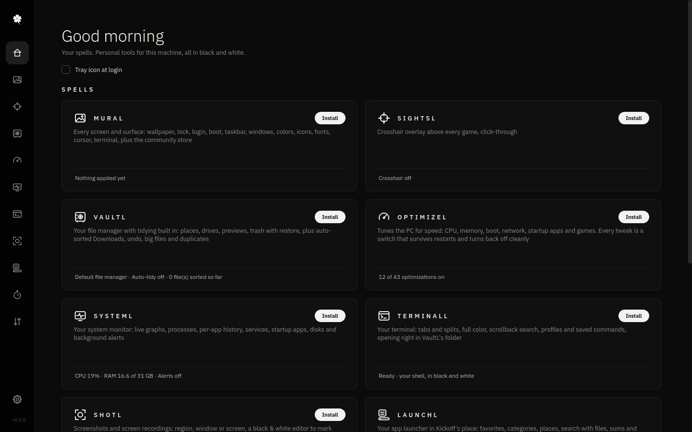

```bash
git clone https://github.com/cookedaj/grimoire-linux.git && cd grimoire-linux && ./install.sh
```

No sudo, no telemetry, uninstalls cleanly. Made for Kubuntu and any KDE Plasma 6 desktop on Wayland.

## Why

Ricing and tuning a Plasma desktop usually means a dozen apps, a dozen looks and a lot of config files. Grimoire
Linux puts the tools you reach for every day into one monochrome app with one design language: a slim icon rail,
line icons, no accent colors. Each tool (a "spell") stays out of your way, changes things the way KDE itself would,
and can undo every change it makes. Anything that needs root says so and asks first.

## Spells

### MuraL: KDE Plasma customization

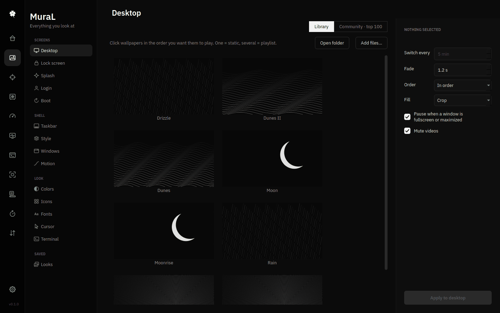

Customize everything you look at: desktop wallpaper with crossfading playlists (images and video), lock screen,
splash, login (SDDM), boot (Plymouth), taskbar, Plasma style, window title bars, motion and effects, colors, icons,
fonts, cursor and terminal. Every tab has live previews, saved **Looks** switch the whole desktop at once, and a
**Community** view lists the top 100 from the KDE Store and Wallhaven, installable in one click.

### SightsL: crosshair overlay for Linux games

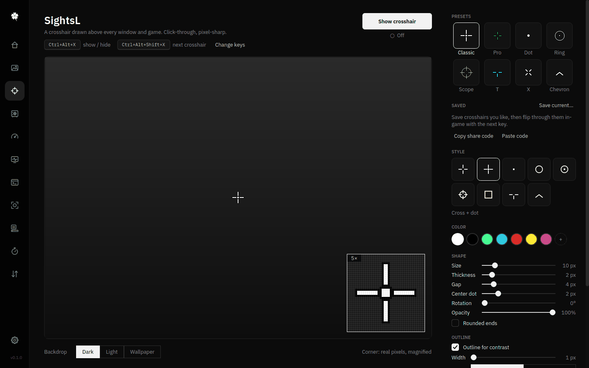

A crosshair drawn above every window and fullscreen game (KDE layer-shell), fully click-through and pixel-sharp.
Presets, saved crosshairs and share codes, rotation, outline, offsets, screen choice, live updates, and global
hotkeys: Ctrl+Alt+X hides it, Ctrl+Alt+Shift+X flips to the next one. It draws an overlay; it never touches a game.

### VaultL: a file manager that tidies itself

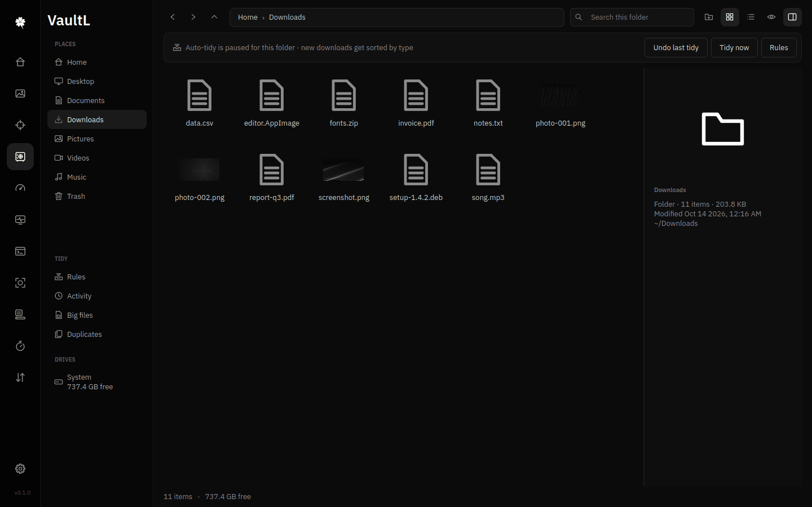

Places and drives, breadcrumbs, a thumbnail grid or details list, a preview panel, Trash with restore,
KDE-compatible copy/cut/paste and Dolphin's keyboard shortcuts. Its **Tidy** section keeps `~/Downloads` sorted by
type in the background, sends stale installers and archives to the Trash, and finds big files and duplicates.
Never deletes: everything goes to the Trash and every move can be undone. Can be your default file manager.

### OptimizeL: speed tweaks as switches

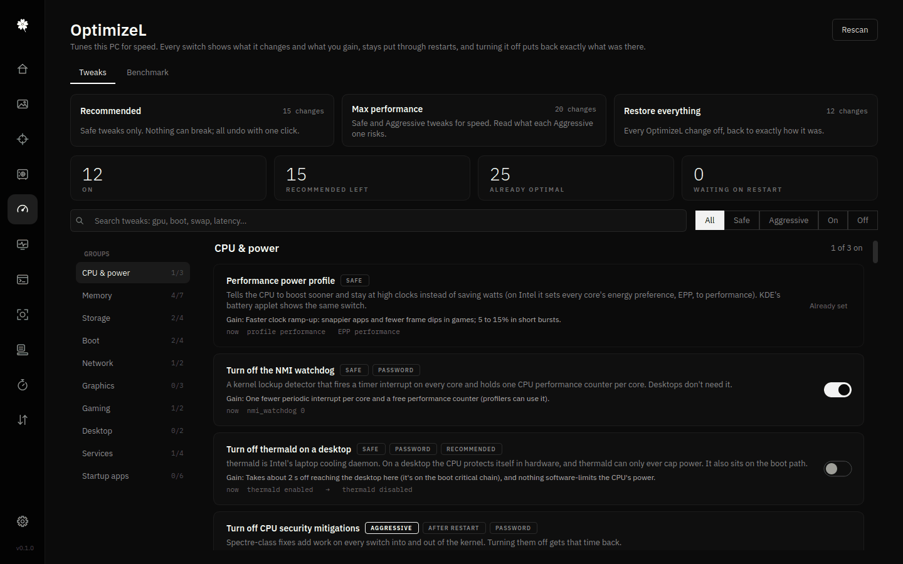

Scans the PC and lays out speed tweaks as on/off switches: power, memory (zram, earlyoom), storage and boot,
network (BBR), services, startup apps, desktop and gaming. Each one says what it changes, what you gain and what it
risks; one-click plans (Recommended, Max performance, Restore everything) and before/after benchmarks. Switches
survive restarts, and turning one off puts back exactly what was there.

### SystemL: a Linux system monitor

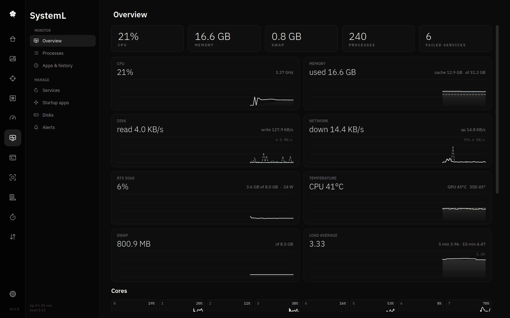

In place of KDE System Monitor: live graphs for CPU (every core), memory, swap, disk, network, GPU, temperatures
and load; a process list with search, tree view, end/force quit and priority; per-app history (what was busy an
hour, a day or a week ago); systemd services with start/stop/logs; startup apps; disks; and background alerts when
memory, temperatures, free space or a stuck app cross the line you set, even while SystemL is closed.

### TerminalL: a black & white terminal

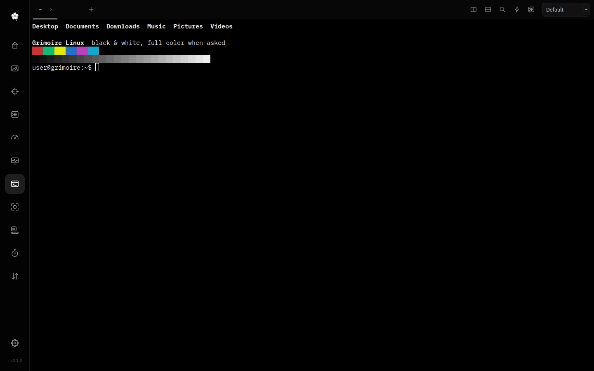

Your shell on a real PTY, in tabs that split side by side or top and bottom. Full 16/256/true color when programs
ask for it, Unicode and wide characters, mouse support for htop and vim, scrollback with search, zoom, profiles,
a palette of saved commands (Ctrl+Shift+P), and new tabs right in VaultL's folder.

### ShotL: screenshots and screen recording

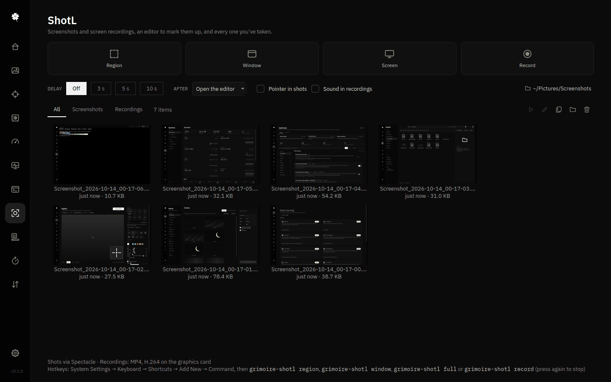

Region, window or whole-screen screenshots, a black & white editor to mark them up, screen recording (H.264 on
the graphics card when it can), and a gallery of every shot. Bind `grimoire-shotl region|window|full|record` to
any key.

### FocusL: a focus timer

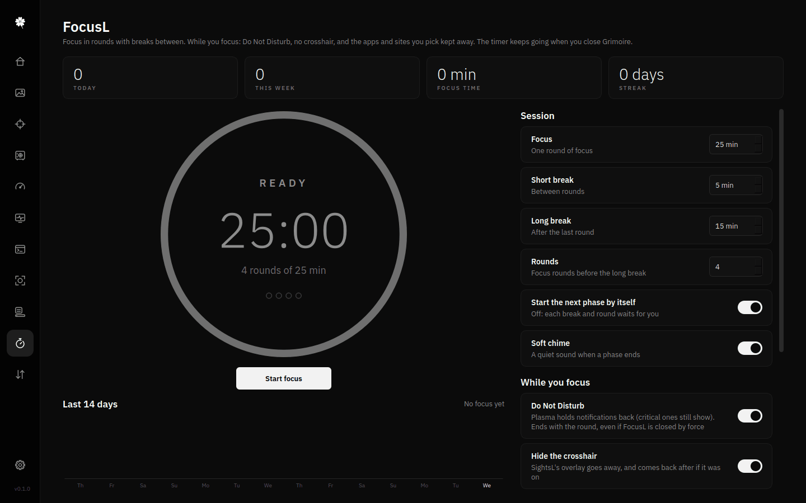

Focus in rounds with breaks. While you focus: Do Not Disturb, no crosshair, and the apps and sites you pick kept
away; then your streak, today, this week and the last 14 days. It keeps running when you close the window.

### NetL: network monitor and quick controls

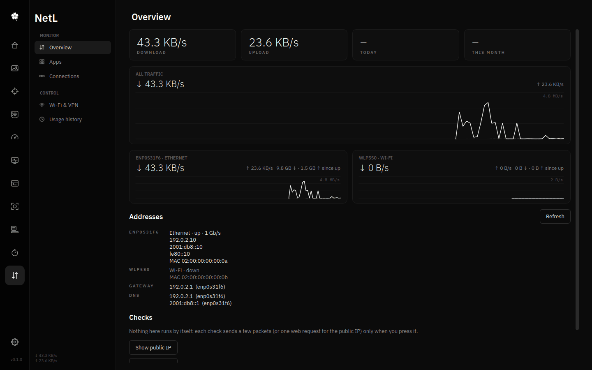

Live download/upload per interface and per app (from the kernel's own TCP counters, no root), connections with
host names, addresses, gateway and DNS, Wi-Fi scan and connect, Wi-Fi/airplane/VPN switches, and daily and monthly
usage. Public IP and ping checks only run when you press them.

### LaunchL: a Plasma app launcher

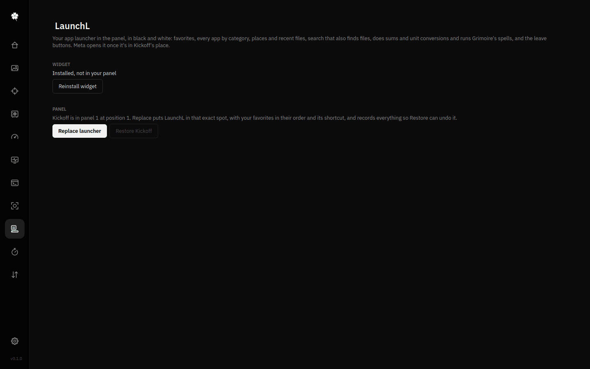

A black & white panel launcher in Kickoff's place: favorites, every app by category, places and recent files,
search that also finds files, does sums and unit conversions and runs Grimoire's spells, plus the leave buttons.
Meta opens it. **Replace launcher** records your Kickoff first, so **Restore Kickoff** puts back exactly what was there.

### Tray, Settings and updates

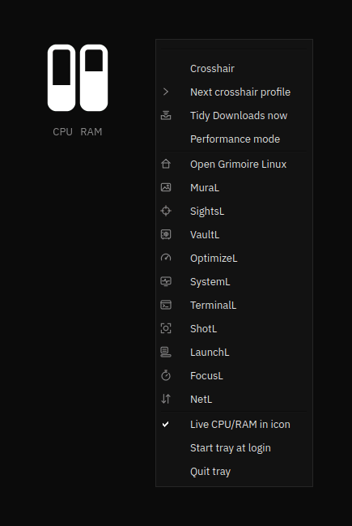

- **Tray icon** (`grimoire-tray`): live CPU/RAM bars in the system tray, with the crosshair, the next crosshair,
  "Tidy Downloads now", Performance mode and every spell in its menu. Optional start at login.
- **Settings** (the gear at the foot of the rail): every Grimoire hotkey in one list (written to KDE's own shortcut
  service, conflicts refused); **Backup & restore** of all settings in one `.grimoire-backup` file, with a preview
  of what would change and a safety backup first; **GitHub** sign-in to keep that backup in a secret gist and
  restore it on another PC; open at login and update checks.
- **Self-update**: Grimoire checks GitHub every few hours. When there's something new, **What's new** lists the
  changes, **Update now** installs them and **Restart now** reloads. Or run `grimoire update`.

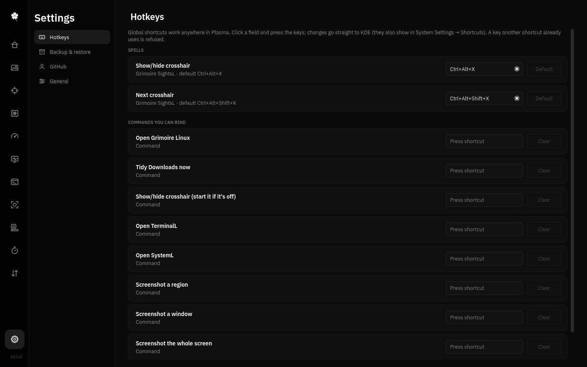

## Install

### From source (recommended)

```bash
git clone https://github.com/cookedaj/grimoire-linux.git
cd grimoire-linux
./install.sh          # add --all to put every spell in the app menu too
grimoire              # or open "Grimoire Linux" from the app menu
```

The installer copies the app into `~/.local/share/grimoire/app`, links the commands into `~/.local/bin`, adds the
menu entries and copies the MuraL wallpaper plugin and LaunchL widget into Plasma. Everything runs from that copy,
so you can move or delete the download afterwards. If `grimoire` isn't found in a terminal, add `~/.local/bin` to
your `PATH` (or log out and back in). A ZIP download from GitHub works the same way.

The four small root helpers (login/boot themes, system tweaks, root actions in SystemL, FocusL's site blocking) are
the one exception to "everything per user": the installer asks for your password once to put them, root-owned, in
`/usr/local/libexec/grimoire-linux`, so nothing running as you can change what runs as root. It asks again only when
a newer version changes them; `./install.sh --no-system` skips this (those features then stay unavailable).

### Packages

- **Debian / Ubuntu / Kubuntu (.deb)**: coming soon on the
  [Releases page](https://github.com/cookedaj/grimoire-linux/releases); then
  `sudo apt install ./grimoire-linux_*_all.deb`.
- **Arch / Manjaro / EndeavourOS (AUR)**: coming soon as `grimoire-linux-git` (`yay -S grimoire-linux-git`).

Packages install system-wide into `/usr/share/grimoire-linux` (root helpers in `/usr/libexec/grimoire-linux`) and
update with your system; the in-app updater is off there.

### Requirements

KDE Plasma 6 (Wayland is best; made on Kubuntu 26.04) and Python 3.12+ with PySide6, Pillow and psutil, plus
layer-shell-qt (SightsL), Qt Multimedia (video wallpapers), pyte (TerminalL) and dbus-python (GitHub sign-in).
Optional: ffmpeg (video thumbnails, recordings), Spectacle (ShotL), NetworkManager (NetL controls), rsync.

```bash
# Ubuntu / Kubuntu / Debian
sudo apt install python3-pyside6.{qtcore,qtgui,qtwidgets,qtsvg,qtdbus,qtnetwork,qtqml,qtquick} python3-pil \
    python3-psutil python3-pyte python3-dbus qml6-module-org-kde-layershell qml6-module-qtmultimedia ffmpeg rsync
# Fedora
sudo dnf install python3-pyside6 python3-pillow python3-psutil python3-pyte python3-dbus layer-shell-qt \
    qt6-qtmultimedia ffmpeg-free rsync
# Arch / Manjaro / EndeavourOS
sudo pacman -S pyside6 python-pillow python-psutil python-pyte python-dbus layer-shell-qt qt6-multimedia ffmpeg rsync
```

### Every spell as its own app

Press **Install** on a spell's card on the home page (or `./install.sh --all`), or run `grimoire-mural`,
`grimoire-sightc`, `grimoire-vaultl`, `grimoire-optimizel`, `grimoire-systeml`, `grimoire-terminall`,
`grimoire-shotl`, `grimoire-focusl` or `grimoire-netl` directly. Command-line helpers:
`grimoire-sightc on|off|toggle|next`, `grimoire-vaultl [folder]`, `grimoire-vaultl tidy run|undo|enable|disable|status`,
`grimoire-systeml alerts check|enable|disable|status`, `grimoire-focusl start|stop|status`, `grimoire update`.

To make VaultL the default file manager: `xdg-mime default grimoire-vaultl.desktop inode/directory` (switch back in
System Settings → Default Applications).

## Uninstall

```bash
~/.local/share/grimoire/app/uninstall.sh            # keeps your settings for a later install
~/.local/share/grimoire/app/uninstall.sh --purge    # also moves settings, logs and cache to the Trash
```

It removes the app, commands, menu entries, the wallpaper plugin (switching your desktop to MuraL's current picture first),
LaunchL (putting Kickoff back first), the timers, the autostart entries and the root helpers in
`/usr/local/libexec/grimoire-linux` (one password prompt). Looks and tweaks you applied stay as
they are, so turn off MuraL themes and OptimizeL switches first if you want them undone. With a package, run
`/usr/share/grimoire-linux/uninstall.sh` as yourself, then remove the package.

## FAQ

### Is it safe?

Grimoire runs as you. The few things that change the system (login and boot themes, system tweaks, other users'
processes, focus-time site blocking) ask for your password through KDE's own prompt and go through small helper
scripts that only know a fixed list of actions, check every argument and keep the old values so you can undo.
Your files are never deleted: they go to the Trash, and name clashes become "name (2)". Community themes are only
downloaded when you press Install, and archives are unpacked defensively. Details: [docs/security.md](docs/security.md).

### What needs root, and why?

Only what lives outside your home: the SDDM login theme and Plymouth boot animation (MuraL), system-wide tweaks such
as sysctl, zram and services (OptimizeL), acting on system services or other users' processes (SystemL), and
`/etc/hosts` for blocking sites while you focus (FocusL). Each asks at the moment you do it, never in the background.

### Does it work on X11 or GNOME?

Grimoire Linux is built for **KDE Plasma 6 on Wayland**, and that's where it's tested. Most windows open on Plasma's
X11 session too, but the crosshair overlay needs Wayland's layer-shell, and MuraL, LaunchL, hotkeys and the tray
speak to Plasma directly. On GNOME or other desktops much of it won't do anything useful; it isn't a goal for now.

### How do updates work?

A source install checks GitHub every few hours (turn it off in Settings → General or with
`GRIMOIRE_NO_UPDATE_CHECK=1`) and shows what changed before installing; your settings, timers and autostart are kept.
`git pull && ./install.sh` works too. Packages update through apt or pacman.

### What about privacy?

No telemetry, no analytics, no accounts needed. The app only goes online when you ask (community store, NetL's
public-IP and ping checks, GitHub backup) and for the update check, which is one request to GitHub's public API.

### How do I uninstall?

See [Uninstall](#uninstall): one command, and `--purge` if you want your settings gone too (to the Trash).

## Documentation

- [How it works](docs/how-it-works.md): where each spell keeps its settings, what it changes and how to undo it,
  plus the code layout
- [Security and privacy](docs/security.md): root helpers, network use, the GitHub sign-in threat model

## Contributing

Issues and pull requests are welcome at [github.com/cookedaj/grimoire-linux](https://github.com/cookedaj/grimoire-linux).
Keep the look strictly black & white (no accent colors; new icons are line glyphs drawn in `grimoire/glyphs.py`),
keep modules small, never delete user files (Trash only), and send anything that needs root through a spell's
whitelisted `root-helper.sh` (run only from its root-owned system copy, see
`grimoire/roothelper.py`). Test UI offscreen (`QT_QPA_PLATFORM=offscreen`) and file operations in a sandbox
folder. `python3 scripts/screenshots.py` regenerates the screenshots; `scripts/release.sh X.Y.Z` prepares a
release; `packaging/build-deb.sh` builds the .deb.

## License

Copyright (C) 2026 cookedaj

Grimoire Linux is free software: you can redistribute it and/or modify it under the terms of the GNU General Public
License as published by the Free Software Foundation, either version 3 of the License, or (at your option) any later
version. See [LICENSE](LICENSE). Files adapted from KDE projects, if any are added, keep their original copyright
and license headers. Wallpapers and community themes you install belong to their creators and aren't part of this
repository.
